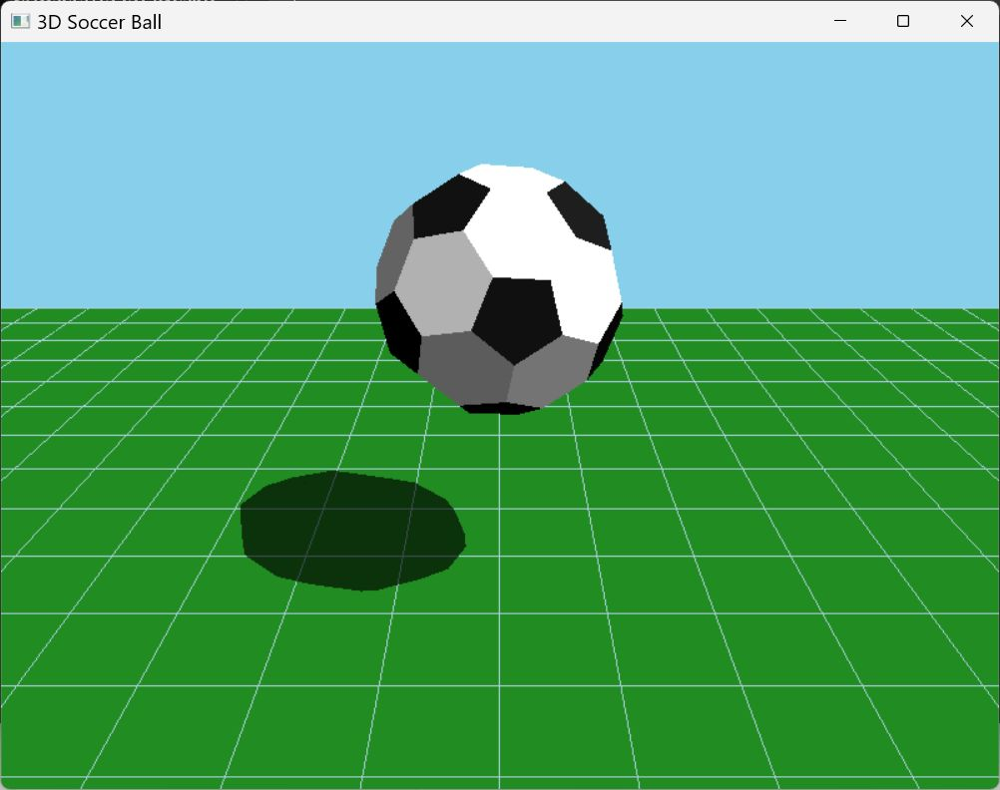

# SoccerAnimation — OpenGL 3D Graphics Coursework

This project was developed for my **Computer Graphics course assignment in December 2025**. It demonstrates procedural 3D modelling and real-time rendering in C++ using OpenGL, GLU, and FreeGLUT.

The program displays a black-and-white soccer ball rotating and moving vertically above a green ground plane, with lighting, a grid, and a projected shadow. The geometry is generated in code, without external models or textures.



## OpenGL techniques

| Technique | Implementation |
| --- | --- |
| **Procedural polygon modelling** | `generateSoccerBall()` interpolates and normalizes points along icosahedron edges to form 20 hexagons and 12 pentagons. Neighboring vertices are deduplicated and sorted by angle in a local tangent plane. |
| **Immediate-mode rendering** | `glBegin`, `glVertex3f`, and `glEnd` draw the ball with `GL_POLYGON`, the floor with `GL_QUADS`, and the grid with `GL_LINES`. |
| **Face normals and flat shading** | Cross products produce face normals, a dot-product test orients them outwards, and `glNormal3f` supplies them to OpenGL. `GL_NORMALIZE` and `glShadeModel(GL_FLAT)` support the faceted appearance. |
| **Fixed-function lighting and materials** | `GL_LIGHT0` provides a positional light. `glLightfv`, `glMaterialfv`, and `glMaterialf` configure ambient, diffuse, and specular components and material shininess for the black and white faces. |
| **Model transformations** | `glTranslatef` changes the ball's height and `glRotatef` rotates it about a diagonal axis. `glPushMatrix` and `glPopMatrix` isolate transformations between drawing passes. |
| **Camera and perspective projection** | GLU's `gluLookAt` and `gluPerspective` define the view and projection. A reshape callback updates the viewport and aspect ratio. |
| **Depth buffering** | `GL_DEPTH_TEST` resolves surface visibility in the main 3D scene. The color and depth buffers are cleared each frame. |
| **Planar projected shadows** | A custom 4×4 matrix projects the ball's geometry onto the ground from the light position. `glMultMatrixf` applies it during a separate shadow pass. |
| **Alpha blending** | `GL_BLEND` with `GL_SRC_ALPHA` and `GL_ONE_MINUS_SRC_ALPHA` produces a translucent shadow and grid. Lighting and depth-test state are adjusted between passes. |
| **Double buffering and timed animation** | `GLUT_DOUBLE` and `glutSwapBuffers` present completed frames. `glutTimerFunc` updates motion and `glutPostRedisplay` requests the next redraw. |

The implementation is in [main.cpp](main.cpp) and uses OpenGL's **compatibility fixed-function pipeline**.

## Configure the environment

The supplied build targets **Windows x64 with MSVC** and was verified with Visual Studio 2026 Community. No game engine is required.

Install Visual Studio Community or Microsoft C++ Build Tools. In Visual Studio Installer, select **Desktop development with C++** and include:

- MSVC C++ x64/x86 build tools;
- a Windows SDK;
- **C++ CMake tools for Windows**, including Ninja.

The matching FreeGLUT headers, x64 import library, and DLL are included in [`third_party/freeglut`](third_party/freeglut). The Windows SDK supplies the OpenGL and GLU development libraries.

## Build and run

Clone this repository, or download and extract it using GitHub's **Code → Download ZIP** option. Open PowerShell in the project folder containing `main.cpp` and run:

```powershell
.\run.cmd
```

You can also double-click `run.cmd`. It discovers the installed Visual Studio tools, builds the project, and launches the animation without permanent changes to `PATH`.

To build without launching:

```powershell
.\build.cmd
```

The executable is generated at `build\bin\Release\SoccerAnimation.exe`. The build automatically copies `freeglut.dll` beside it.

Alternatively, open the project folder in Visual Studio as a CMake project, select an **x64** configuration and the **SoccerAnimation** target, then build and run it. Visual Studio may use its own output directory.

## What to expect

- An initially **800 × 600** window titled **3D Soccer Ball** displays the animation.
- The animation starts automatically; no keyboard input, mouse input, command-line arguments, or data files are required.
- Resize the window to update the viewport and projection. Use the window's close button to exit.
- Vertical motion follows `abs(sin(animTime)) * 2.5`, and rotation advances on each timer callback. This is prescribed animation rather than a gravity or collision simulation.
- Updates are requested approximately every 16 ms; actual timing depends on the system.

## Project structure

```text
SoccerAnimation/
├── README.md                Project overview and setup instructions
├── README.txt               Plain-text documentation
├── main.cpp                 Original coursework source
├── CMakeLists.txt           Standalone C++/OpenGL build configuration
├── build.cmd                Configure and compile a Release build
├── run.cmd                  Build and launch the animation
├── .gitignore               Exclude generated files from Git
├── tools/
│   └── msvc-env.cmd         Discover the Visual Studio x64 toolchain
├── docs/
│   └── screenshot.png       Screenshot of the animation
└── third_party/freeglut/
    ├── include/GL/          FreeGLUT headers
    ├── lib/freeglut.lib     x64 import library
    ├── bin/freeglut.dll     x64 runtime library
    ├── LICENSE.txt          FreeGLUT license
    └── PACKAGE-README.txt   Original dependency package information
```

## Troubleshooting

| Problem | Action |
| --- | --- |
| Visual Studio C++ tools or CMake tools are missing | Add the workload and components listed above through Visual Studio Installer. |
| `GL/glut.h` cannot be found, or FreeGLUT cannot be linked | Keep the entire `third_party` folder and build with x64 MSVC. |
| `freeglut.dll` cannot be found | Rebuild with `build.cmd` and keep the generated DLL beside the executable. |
| `VCRUNTIME140.dll` or `MSVCP140.dll` cannot be found | Install the matching x64 [Microsoft Visual C++ Redistributable](https://learn.microsoft.com/en-us/cpp/windows/latest-supported-vc-redist). |
| The executable cannot be overwritten during a build | Close the running animation before rebuilding. |
| A double-to-float conversion warning appears | The original geometry code contains this conversion; it does not prevent the verified build from running. |

## Coursework and dependencies

The original assignment source is preserved in `main.cpp`. The standalone build configuration and documentation were added when preparing the project for portfolio review.

FreeGLUT is a third-party dependency. Its [license](third_party/freeglut/LICENSE.txt) and [original package information](third_party/freeglut/PACKAGE-README.txt) are included alongside the library.

For compiler setup, see Microsoft's [C++ installation guide](https://learn.microsoft.com/en-us/cpp/build/vscpp-step-0-installation).
